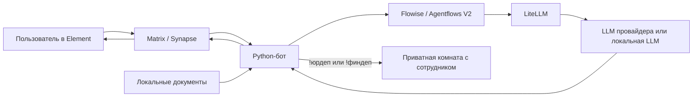

# STS: ИИ-поддержка через Matrix и Element

Проект Руслана для демонстрации. Пользователь общается с ЮрАгентом и ФинАгентом в Element. Бот ищет сведения в локальных документах и отвечает через LiteLLM. Если нужна помощь человека, бот передаёт обращение одному из пяти сотрудников нужного департамента в отдельную приватную переписку.

## Что входит

- **Element Web** — интерфейс чата; **Synapse** — Matrix-сервер сообщений.
- **Python-бот / matrix-nio** — обработка вопросов, выбор специализации, локальный поиск по документам, оформление ответов с цитатами, передача человеку.
- **LiteLLM** — общий шлюз моделей. По умолчанию `legal-chat` → `astanahub/alemllm` через NITEC. Другие настроенные маршруты: DeepSeek, Kimi и GPT-OSS; их доступность зависит от прав вашего ключа и провайдера.
- **104 локальных документа, выдержки и конспекта (30 PDF + 74 TXT)** — законы РК и официальные банковские/регуляторные материалы. Версии и SHA-256 записаны в `offline_knowledge/manifest.json`. Это база для поиска, а не обучение весов модели; материалы требуют обновления при изменении документов.
- **ЮрДеп / ФинДеп** — по пять аккаунтов живых сотрудников. Новые переписки распределяются по кругу. Пользователь может выбрать номер сотрудника или перейти к другому, сохранив прежнюю комнату. Присутствие и занятость пока не проверяются; подробнее в [docs/departments.md](docs/departments.md).
- **FastAPI + PostgreSQL + операторская React-панель** — отдельный демонстрационный API тикетов. Переписки департаментов хранятся в Matrix; панель тикетов пока не является очередью этих переписок.



Подключение Multica удалено из кода. На текущей VM основные и дополнительные комнаты используют два **Agentflows V2**: тип вопроса и источники → черновик → построчная проверка доказательств → ответ либо одна доработка и повторная проверка. Новая схема описана в [docs/flowise.md](docs/flowise.md#проверка-утверждений-и-однократная-доработка-22102026). Поиск, окончательная проверка цитат и передача человеку остаются в Python. [Результаты обновления и проверки 22.10](reports/agentflow-claims-20261022.md). Типовые проверенные объяснения могут обходить модель. Для новой установки Flowise включается отдельно; см. [инструкцию](docs/flowise.md).

**Исторический пилот Flowise от 09.10:** **131 тест прошёл**; оба специалиста проверены реальными сообщениями Matrix через Flowise и LiteLLM (`legal-chat-qwen38-int4`). Две отдельные комнаты «Flowise (тест)» используют выделенный ограниченный ключ. В тот момент основные комнаты продолжали обращаться к LiteLLM напрямую; это описание исторического пилота, а не текущей схемы. Исправлен поиск возраста вступления в брак и строки тарифа Halyk SuperApp. Это проверка двух сценариев, а не полная оценка юридического/финансового качества. [Отчёт проверки](reports/flowise-pilot-20261009.json).

Проверка полезности ответа и привязанные к первоисточникам планы объяснений описаны в [короткой справке по качеству](docs/ANSWER-QUALITY-RU.md). Для знакомства с файлами и подготовки к обсуждению кода — [разбор проекта](docs/PROJECT-EXAM-RU.md).

## Запуск на новой машине

Нужны Docker Engine / Docker Desktop с Compose v2 и Python 3. Обычная установка использует собственный ключ NITEC; для закрытой сети предусмотрен [отдельный локальный профиль](docs/OFFLINE.md), которому заранее нужны образы, зависимости и модель.

```bash
git clone https://github.com/oelsq/sts-matrix-support.git
cd sts-matrix-support
python3 scripts/setup.py init
```

Скрипт создаст локальную `.env`, случайные пароли и конфигурацию Synapse. Для обычной установки затем **заполните свой `NITEC_API_KEY` в `.env`**; для автономной выполните настройку из `docs/OFFLINE.md`. Не используйте секреты прежней VM.

```bash
python3 scripts/setup.py start
```

Это поднимет отдельный Compose-проект с собственной базой данных, создаст ограниченный ключ LiteLLM, пользователя `ruslan`, бота и десять сотрудников. Создаются две новые комнаты ЮрАгента и ФинАгента; идентификаторы предыдущей VM не используются.

- Element: **http://localhost:8081**.
- Операторская панель тикетов: **http://localhost:8080**.
- Проверка backend: **http://localhost:8010/health**.
- Логины и пароли **вашей новой установки**: `runtime/accounts.txt`.

Войдите в Element под `ruslan`. Пишите в нужном чате. Для человека отправьте `!юрдеп`, `!финдеп` или `!человек`. Команда `!сотрудники` покажет выбор: например, `!финдеп2` открывает переписку со вторым сотрудником, а `!другой` переводит к следующему. Для смены вернитесь в чат ИИ. `!помощь` показывает команды. Сотрудник входит в отдельном профиле браузера, принимает приглашение и отвечает вручную. Создание аккаунтов не заменяет настоящих сотрудников.

Повторный запуск `setup.py start` сохраняет созданные аккаунты, комнаты, ключ и базы. `docker compose down` останавливает установку и сохраняет данные; **`down -v` удаляет PostgreSQL-данные**. Не изменяйте `MATRIX_SERVER_NAME` для уже созданного homeserver.

## Если сервер удалённый

Для существующей VM `sts-vm-06` используется новый Teleport `ztna.nitec.kz`; вход и команда двух туннелей описаны в [доступе к VM](docs/vm-access.md).

По умолчанию опубликованные порты привязаны к `127.0.0.1`. Для SSH-туннеля:

```bash
ssh -N -L 18081:127.0.0.1:8081 <user>@<server>
```

До `init` задайте `ELEMENT_PUBLIC_URL=http://localhost:18081` в `.env`. Для уже подготовленной конфигурации измените этот адрес в `.env` и `runtime/element-config.json`, затем перезапустите Element и бота. Для нескольких пользователей внутри сети настройте общий HTTPS-адрес через reverse proxy и укажите его в `ELEMENT_PUBLIC_URL`; `/_matrix/` уже проксируется через Element к Synapse. Не путайте адрес сервиса Docker `homeserver:8008` с адресом браузера.

## Модели и знания

- Маршруты моделей: `config/litellm/config.yaml`.
- Выбор модели по роли: `LEGAL_LLM_MODEL`, `FINANCE_LLM_MODEL`, `GENERAL_LLM_MODEL` в `.env`.
- Инструкции ролей: `matrix_support_bot/agents/legal.md` и `finance.md`.
- PDF и тексты: `offline_knowledge/documents/`; каталог и версии: `offline_knowledge/manifest.json`.
- Поиск, проверка ссылок и оформление: `offline_knowledge.py`, `agents.py`, `message_format.py`.

После изменения модели: `docker compose up -d --force-recreate bot`. После изменения конфигурации шлюза: `docker compose restart litellm`. После добавления PDF обновите manifest по [инструкции](docs/knowledge.md), перезапустите бота и проверьте цитаты. Одного URL документа недостаточно: боту нужен локальный документ с извлекаемым текстом.

**По умолчанию генерация ответа требует соединения с NITEC.** Локальные PDF и LiteLLM сами по себе не делают систему автономной. Для изолированной сети используйте [docs/OFFLINE.md](docs/OFFLINE.md): профиль локального инференса, статический preflight и внутреннюю Docker-сеть. При `OFFLINE_MODE=1` скрипт `start` не требует ключа NITEC и не скачивает/не собирает образы. Полностью автономная работа подтверждается только проверкой на целевом сервере с отключённым внешним каналом.

## Улучшения ответов от 07.10.2026

Короткий прямой ответ, затем практические шаги и нужные уточнения; источники и цитаты оформляются отдельно. Расширены бытовые формулировки поиска, приоритет профильных законов и контекст коротких уточнений. Добавлены девять PDF-снимков: Гражданский кодекс (две части), Уголовный кодекс, жилищные отношения, исполнительное производство, микрофинансы, коллекторы, банкротство граждан и гарантирование депозитов.

Черновик проходит второй запрос к модели для сверки с документами; сервер отдельно проверяет ссылки, цитаты и часть числовых утверждений. При нехватке подтверждений бот даёт ограниченные организационные советы и уточняет недостающие факты. Проверки не гарантируют юридическую правильность любого ответа: модель может неверно истолковать условие или исключение.

В узких сценариях бесплатной юридической помощи, неисправного телефона и арендного депозита используются проверенные разъяснения, привязанные к найденным положениям закона. В тестировании модель иногда ошибочно относила телефон к технически сложным товарам и определяла режим арендного платежа только по его названию; эти случаи получили отдельные проверки и не зависят от повторной генерации.

На исходной VM для обеих ролей выбран существующий локальный маршрут LiteLLM `legal-chat-qwen38-int4` → `openai/qwen3.8-int4-lab`. Это имя настроенного сервиса; веса модели здесь не обучались и не переименовывались. Этот локальный сервер не входит в переносимую сборку. На новой установке сохранён доступный через NITEC маршрут `legal-chat`; Амиржан может подключить собственную локальную модель и выбрать её в `.env`. При добавлении нового имени маршрута нужно также разрешить его в ключе LiteLLM. Существующий код создания ключа в `scripts/setup.py` разрешает четыре маршрута из `config/litellm/config.yaml`.

Версия от 07.10 прошла **94 автоматических теста** и проверку восьми учебных вопросов через реальный LiteLLM. Проверены оформление, подбор источников, исключения, неподтверждённые числа и отсутствие подмены тарифов. Это функциональная проверка, а не сертификация юридических консультаций. Отчёт: `reports/agent-quality-20261007.json`.

## Помощь по существу до передачи сотруднику

Убрана автоматическая приписка о департаменте в обычных ответах. Ответ модели с одной рекомендацией сотрудника или списком вместо запрошенного письма проходит повторную проверку. При недоступной модели остаются ограниченные полезные шаги. Новые сценарии и честное разделение локальной/реальной проверки описаны в [docs/helpfulness.md](docs/helpfulness.md).

## Локальная проверка 21.10.2026

Работа выполнена без VM и без реальных вызовов модели. Расширены поиск по бытовым формулировкам и запросам конкретных статей, проверка единиц измерения чисел, учебные материалы по личным финансам. Исправлены dev-proxy интерфейса, воспроизводимость frontend-зависимостей (Vite 6.4.5, сборочный Node 22), входная валидация демонстрационного API и запуск тестов из корня.

```bash
python -m venv .venv
.venv/bin/pip install -r matrix_support_bot/requirements.lock.txt
DATABASE_URL=sqlite:////tmp/sts-test.sqlite3 .venv/bin/python -m pytest -q
.venv/bin/python scripts/evaluate_answers.py --output /tmp/sts-retrieval.json
```

Эти проверки не делают модель равной ChatGPT/Gemini и не обучают её веса. Итоговые числа и границы проверки записаны в [отчёте](reports/local-audit-20261021.md). Демонстрационный API тикетов возвращает `Echo`; реальные ответы ИИ в Element проходят через Python-бот и настроенный LiteLLM/Flowise. Панель тикетов пока не заменяет очередь департаментов.

## Проверки и ограничения

На новой изолированной установке также прошли **73 автоматических теста**, вопросы обоим агентам с локальными PDF и HTML-цитатами, а также передача в ФинДеп. Для этой проверки использовался синтетический локальный LLM-сервис без действующего ключа провайдера; она подтверждает сборку и доставку, а не качество реальной модели. Отчёт: `reports/new-install-e2e-20261006.json`.

На исходной VM прошли **73 автоматических теста**, проверены входы десяти сотрудников и четыре сценария передачи обращения. Исторические результаты находятся в `reports/`; они не заменяют проверку вашей новой установки. Это функциональная демонстрация, без нагрузочного подтверждения 500 обращений в день.

```bash
docker compose run --rm --no-deps -e TEST_KNOWLEDGE_DIR=/app/offline_knowledge --entrypoint python bot -c 'from app import models,database; models.Base.metadata.create_all(bind=database.engine); import pytest; raise SystemExit(pytest.main(["-q", "/app/tests"]))'
docker compose ps
docker compose logs --tail=100 bot
```

Комнаты демонстрации **без E2EE**. Для рабочей эксплуатации нужны HTTPS, политики доступа, резервное копирование, проверка юридических/финансовых ответов и согласованный порядок обновления источников. При недостаточных сведениях агент должен сообщать об этом, а пользователь может обратиться к живому сотруднику.

## Данные и секреты

В Git нет прежних паролей, токенов, переписок, SQLite-состояния, данных PostgreSQL или сессий Teleport. `.env` и весь `runtime/` исключены через `.gitignore`. Пароли новой установки генерируются локально. Сохраняйте отдельно `.env`, `runtime/` и PostgreSQL volume, если нужен перенос уже работающей установки вместе с историей.


Обновление 07.10.2026: добавлены локальные PDF-снимки законов «О воинской службе и статусе военнослужащих» и «Об органах национальной безопасности Республики Казахстан» (источник — ИПС Әділет). Поиск учитывает слова «армия», «военкомат», «КНБ». Если справочный вопрос не обеспечен источником, бот сообщает конкретный пробел вместо шаблонного списка действий для спора. В журнале различаются отсутствие источников и отклонение ответа при проверке.

Исправления справочных ответов от 07.10: **100 тестов прошли**, добавлены законы о воинской службе и органах национальной безопасности. Проверены два вопроса через работающий LiteLLM. Отчёт: `reports/reference-answers-20261007.json`. Эта проверка не подтверждает безошибочность ответов на все юридические темы.

Расширение правового корпуса: семейное, процессуальное, административное, налоговое, социальное право и другие основные отрасли. В Element команда `!темы` показывает охват. Полнота всего законодательства не заявляется; см. `offline_knowledge/coverage.json`. Импорт официальных текстов для проверки: `python scripts/import_legal_sources.py --catalog offline_knowledge/legal-catalog.json --staging official-source-staging`. Он не обновляет активную базу автоматически.

Проверка расширенного корпуса: **119 автоматических тестов прошли**, восемь учебных вопросов проверены через работающий LiteLLM. Проверка формата ссылок и чисел не удостоверяет правильность юридического толкования. На VM бот загрузил 24 814 фрагментов и успешно вошёл в Matrix. Отчёт: `reports/legal-corpus-20261007.json`.

Flowise: отдельные Chatflows черновика и проверки — историческая конфигурация. На VM используются Agentflows V2; состояние развёртывания и пределы проверки указаны в датированных отчётах в `reports/`. Подключение новых установок выполняется скриптом `scripts/enable_flowise.py`. Инструкции, настройки и откат описаны в [docs/flowise.md](docs/flowise.md).


Расширение знаний 21.10.2026: добавлены 24 полных официальных закона, настроен поиск по 96 дополнительным вопросам и конкретные объяснения по кредитной истории, профсоюзам, долевому строительству и автострахованию. Условия источников, будущие положения и границы локальной проверки описаны в [отчёте расширения](reports/knowledge-expansion-20261021.md). Это расширение установлено на VM 22.10; результаты серверной проверки — в [отчёте обновления](reports/vm-update-20261022.md).

Проверка числовых утверждений, точные цитаты и восстановление запросов после перезапуска: [docs/reliability.md](docs/reliability.md).

Эталонные сценарии, оценки специалистов, нагрузочные проверки и обновление знаний: [docs/quality-program.md](docs/quality-program.md).

Смысловой поиск в закрытой сети, установка закреплённой модели и проверка индекса: [docs/offline-semantic-search.md](docs/offline-semantic-search.md). Принудительный модельный прогон и закрытый пакет для специалистов описаны в [docs/quality-program.md](docs/quality-program.md).

## Реальные проверки Matrix от 29.10.2026

Проведены два прогона по 280 синтетических сценариев через настоящий Matrix и рабочие Agentflows. Исправлены распознавание просьб о тексте и подготовке документов, вопросы о выборе сотрудника, нейтральные письма и продолжения расчётов. Исходные критерии и подтверждённые дефекты критериев отражаются отдельно; веса модели не менялись. [Отчёт и ограничения](reports/matrix-campaign-20261029.md), [инструменты и каталоги](docs/matrix-campaigns.md).

Проверка актуальности и история редакций: [docs/knowledge-refresh.md](docs/knowledge-refresh.md).
