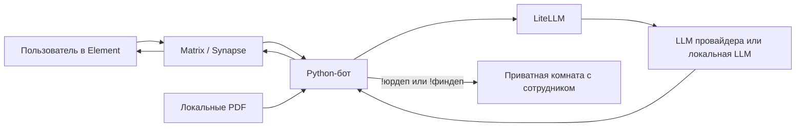

# STS: ИИ-поддержка через Matrix и Element

Проект Руслана для демонстрации. Пользователь общается с ЮрАгентом и ФинАгентом в Element. Бот ищет сведения в локальных PDF и отвечает через LiteLLM. Если нужна помощь человека, бот передаёт обращение одному из пяти сотрудников нужного департамента в отдельную приватную переписку.

## Что входит

- **Element Web** — интерфейс чата; **Synapse** — Matrix-сервер сообщений.
- **Python-бот / matrix-nio** — обработка вопросов, выбор специализации, локальный поиск по PDF, оформление ответов с цитатами, передача человеку.
- **LiteLLM** — общий шлюз моделей. По умолчанию `legal-chat` → `astanahub/alemllm` через NITEC. Другие настроенные маршруты: DeepSeek, Kimi и GPT-OSS; их доступность зависит от прав вашего ключа и провайдера.
- **16 локальных PDF** — законы РК и официальные банковские/регуляторные материалы. Версии и SHA-256 записаны в `offline_knowledge/manifest.json`. Это база для поиска, а не обучение весов модели; материалы требуют обновления при изменении документов.
- **ЮрДеп / ФинДеп** — по пять аккаунтов живых сотрудников. Новые переписки распределяются по очереди; существующая переписка сохраняет сотрудника. Проверки занятости и автоматического переназначения пока нет.
- **FastAPI + PostgreSQL + операторская React-панель** — отдельный демонстрационный API тикетов. Переписки департаментов хранятся в Matrix; панель тикетов пока не является очередью этих переписок.



**Multica не участвует в текущем потоке ответов.** Исторический bridge-модуль сохранён в исходниках, но отключён (`AGENT_BACKEND=llm`).

## Запуск на новой машине

Нужны Docker Engine / Docker Desktop с Compose v2, Python 3 и свой рабочий ключ NITEC. На сервере без выхода в интернет заранее понадобятся Docker-образы, зависимости и локальная модель.

```bash
git clone https://github.com/oelsq/sts-matrix-support.git
cd sts-matrix-support
python3 scripts/setup.py init
```

Скрипт создаст локальную `.env`, случайные пароли и конфигурацию Synapse. Затем **заполните свой `NITEC_API_KEY` в `.env`**. Не используйте секреты прежней VM.

```bash
python3 scripts/setup.py start
```

Это поднимет отдельный Compose-проект с собственной базой данных, создаст ограниченный ключ LiteLLM, пользователя `ruslan`, бота и десять сотрудников. Создаются две новые комнаты ЮрАгента и ФинАгента; идентификаторы предыдущей VM не используются.

- Element: **http://localhost:8081**.
- Операторская панель тикетов: **http://localhost:8080**.
- Проверка backend: **http://localhost:8010/health**.
- Логины и пароли **вашей новой установки**: `runtime/accounts.txt`.

Войдите в Element под `ruslan`. Пишите в нужном чате. Для человека отправьте `!юрдеп`, `!финдеп` или `!человек`. Сотрудник входит в отдельном профиле браузера, принимает приглашение и отвечает вручную. Создание аккаунтов не заменяет настоящих сотрудников.

Повторный запуск `setup.py start` сохраняет созданные аккаунты, комнаты, ключ и базы. `docker compose down` останавливает установку и сохраняет данные; **`down -v` удаляет PostgreSQL-данные**. Не изменяйте `MATRIX_SERVER_NAME` для уже созданного homeserver.

## Если сервер удалённый

По умолчанию опубликованные порты привязаны к `127.0.0.1`. Для SSH-туннеля:

```bash
ssh -N -L 18081:127.0.0.1:8081 <user>@<server>
```

До `init` задайте `ELEMENT_PUBLIC_URL=http://localhost:18081` в `.env`. Для уже подготовленной конфигурации измените этот адрес в `.env` и `runtime/element-config.json`, затем перезапустите Element и бота. Для нескольких пользователей внутри сети настройте общий HTTPS-адрес через reverse proxy и укажите его в `ELEMENT_PUBLIC_URL`; `/_matrix/` уже проксируется через Element к Synapse. Не путайте адрес сервиса Docker `homeserver:8008` с адресом браузера.

## Модели и знания

- Маршруты моделей: `config/litellm/config.yaml`.
- Выбор модели по роли: `LEGAL_LLM_MODEL`, `FINANCE_LLM_MODEL`, `GENERAL_LLM_MODEL` в `.env`.
- Инструкции ролей: `matrix_support_bot/agents/legal.md` и `finance.md`.
- PDF: `offline_knowledge/documents/`; каталог и версии: `offline_knowledge/manifest.json`.
- Поиск, проверка ссылок и оформление: `offline_knowledge.py`, `agents.py`, `message_format.py`.

После изменения модели: `docker compose up -d --force-recreate bot`. После изменения конфигурации шлюза: `docker compose restart litellm`. После добавления PDF обновите manifest по [инструкции](docs/knowledge.md), перезапустите бота и проверьте цитаты. Одного URL документа недостаточно: боту нужен локальный текст PDF.

**По умолчанию генерация ответа требует соединения с NITEC.** Локальные PDF и локальный LiteLLM сами по себе не делают систему автономной. Для изолированной сети Амиржан должен подключить локальную LLM в конфигурации LiteLLM и включить `OFFLINE_MODE=1`; локальные источники уже включены. Текущий `start` проверяет наличие ключа; для локального провайдера используйте значение, которое принимает ваш провайдер, или `dummy`, если он не требует аутентификации, и замените модели/endpoint в конфигурации.

## Проверки и ограничения

На новой изолированной установке также прошли **73 автоматических теста**, вопросы обоим агентам с локальными PDF и HTML-цитатами, а также передача в ФинДеп. Для этой проверки использовался синтетический локальный LLM-сервис без действующего ключа провайдера; она подтверждает сборку и доставку, а не качество реальной модели. Отчёт: `reports/new-install-e2e-20261006.json`.

На исходной VM прошли **73 автоматических теста**, проверены входы десяти сотрудников и четыре сценария передачи обращения. Исторические результаты находятся в `reports/`; они не заменяют проверку вашей новой установки. Это функциональная демонстрация, без нагрузочного подтверждения 500 обращений в день.

```bash
docker compose run --rm --no-deps -e TEST_KNOWLEDGE_DIR=/app/offline_knowledge --entrypoint python bot -c 'from app import models,database; models.Base.metadata.create_all(bind=database.engine); import pytest; raise SystemExit(pytest.main(["-q", "/app/tests"]))'
docker compose ps
docker compose logs --tail=100 bot
```

Комнаты демонстрации **без E2EE**. Для рабочей эксплуатации нужны HTTPS, политики доступа, резервное копирование, проверка юридических/финансовых ответов и согласованный порядок обновления источников. При недостаточных сведениях агент должен сообщать об этом, а пользователь может обратиться к живому сотруднику.

## Данные и секреты

В Git нет прежних паролей, токенов, переписок, SQLite-состояния, данных PostgreSQL или сессий Teleport. `.env` и весь `runtime/` исключены через `.gitignore`. Пароли новой установки генерируются локально. Сохраняйте отдельно `.env`, `runtime/` и PostgreSQL volume, если нужен перенос уже работающей установки вместе с историей.
