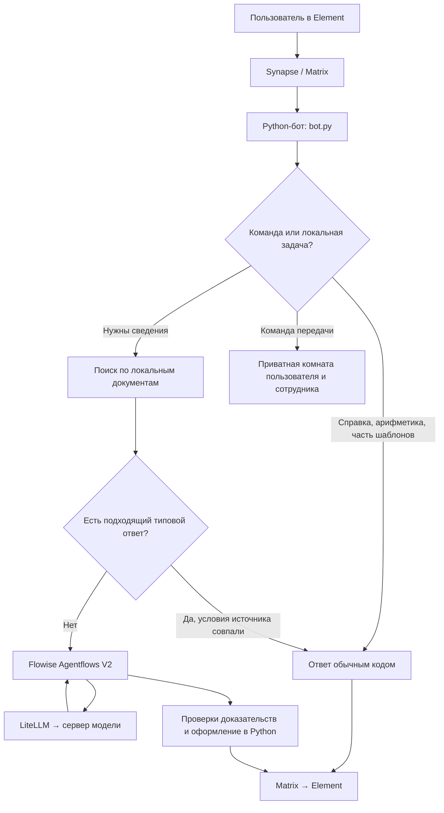

# Как объяснить STS Matrix Support руководителю

Шпаргалка по локальному коду на 2 ноября 2026 года. Код приложения при подготовке не менялся. Исторические отчёты описывают свои даты, а не состояние любой новой установки.

## 1. Рассказ на одну минуту — можно произнести вслух

«Я разработал проект юридической и финансовой поддержки в корпоративном чате. Пользователь пишет в Element, сообщения хранит и передаёт сервер Synapse по протоколу Matrix. Python-бот получает вопрос, определяет специализацию, учитывает предыдущий вопрос пользователя и ищет подходящие фрагменты в локальных документах.

Для простых расчётов, справки и некоторых типовых ответов используется обычный код. Для остальных вопросов подключён Flowise Agentflows V2: модель пишет черновик, затем проверяются его утверждения и подтверждающие выдержки. Если нужны исправления, предусмотрена ограниченная доработка. Доступ к генератору организован через LiteLLM. Ответ оформляется с абзацами и источниками и возвращается в Element.

Если человек хочет помощь сотрудника, он выбирает юридический или финансовый департамент. Настроено по пять аккаунтов сотрудников; можно выбрать конкретного и сменить его. Есть автоматические тесты, проверки поиска, реальные синтетические диалоги и нагрузочные испытания. Проект находится на стадии внутреннего пилота; результаты автотестов не заменяют юридическую экспертизу».

## 2. Семь понятий, которые нужно различать

| Понятие | Простое объяснение |
|---|---|
| Element | Готовое приложение, в котором пользователь видит чат. Мы подключаем и настраиваем его. |
| Matrix | Протокол обмена сообщениями: правила общения клиентов и серверов. |
| Synapse | Конкретный сервер, реализующий Matrix: аккаунты, комнаты, история, приглашения. |
| Python-бот | Написанная в проекте прикладная логика: получение вопроса, поиск, проверки, команды, отправка ответа. |
| Flowise / Agentflows V2 | Визуально задаваемая последовательность обработки: черновик, проверка, ветвление, доработка. |
| LiteLLM | Шлюз к моделям через общий API и имена маршрутов. Не сама нейросеть. |
| LLM | Генератор текста, который исполняется на сервере инференса или у провайдера. |

**Инференс** — получение ответа уже обученной модели. **Обучение** — изменение её весов. В этом проекте веса модели не обучались.

**RAG** — найти нужный текст в документах и передать его модели вместе с вопросом. Добавление PDF расширяет доступную базу, но не переписывает память модели.

## 3. Общая архитектура

Не каждый ответ проходит через Flowise. Это намеренно: для вычисления 27% от суммы не требуется несколько обращений к языковой модели.

## 4. Путь одного вопроса — что именно делает код

Возьмём диалог: «Начальник не отдаёт деньги за работу», затем «А как написать требование?».

1. Пользователь отправляет сообщение в Element. Synapse создаёт Matrix-событие с идентификатором.
2. `bot.py` получает события через библиотеку `matrix-nio` и механизм Matrix sync. Это получение событий, а не чтение экрана браузера.
3. `matrix_inbox.py` сохраняет входящее событие в SQLite. `matrix_delivery.py` организует обработку очереди и исходящие ответы.
4. `process_event()` в `bot.py` исключает собственные сообщения бота и переписки, переданные людям. Затем проверяет обратную связь, справку, сброс контекста и команды департаментов.
5. `agents.route_for_room()` выбирает роль. В закреплённой юридической комнате используется `legal`; в финансовой — `finance`. Для незакреплённых комнат есть тематические правила.
6. `ask_agent()` вызывает `conversation.py`: продолжение связывается с предыдущим вопросом того же пользователя в той же комнате и специализации. Старый ответ ИИ не считается доказательством закона.
7. `local_reply.py` сначала проверяет возможность ответить без LLM: справка, арифметика, организационный шаблон или узкий ответ по найденному источнику.
8. При необходимости `offline_knowledge.py` ищет фрагменты. `retrieval_intents.py` помогает перевести бытовую формулировку в поисковые слова и приоритет нужной статьи. `evidence_scope.py` ограничивает неподходящие темы/продукты, `evidence_neighbors.py` добавляет доступные соседние условия и исключения.
9. Если нужен генератор, `agents.messages()` собирает инструкции роли, вопрос, контекст и источники. `flowise_client.py` передаёт пакет в нужный Agentflow.
10. Agentflow подготавливает черновик и проверяет его. `quality_reply.py` управляет вызовом и при необходимости одним дополнительным локальным поиском в пределах общего времени.
11. Python проверяет ссылки, цитаты, числовые связи и полезность ответа. `message_format.py` создаёт HTML для Element и обычный текст для совместимости.
12. Ответ отправляется через Matrix. Стабильные идентификаторы исходящих операций уменьшают риск дублирования при повторной доставке.

Для второго сообщения задача уже другая: подготовить текст требования с заполнителями, а не повторить общий совет. Поэтому контекст и распознавание типа задачи важны не меньше самой модели.

## 5. Как устроены ЮрАгент и ФинАгент

Это две специализации общей программы. Само слово «агент» здесь не означает отдельную обученную нейросеть или сотрудника.

| Что отличается | Где задаётся |
|---|---|
| Назначение комнаты: право / финансы | Файл маршрутов комнаты, загружаемый `bot.py`; на VM это рабочее состояние, не общий публичный список комнат. |
| Инструкции юридического помощника | `matrix_support_bot/agents/legal.md`. |
| Инструкции финансового помощника | `matrix_support_bot/agents/finance.md`. |
| Подбор и допустимость материалов | `offline_knowledge.py`, `retrieval_intents.py`, `evidence_scope.py`, метаданные корпуса. |
| Нужный Flowise-поток | Маршруты `FlowiseClient`; отдельно настроены юридический и финансовый Agentflows V2. |
| Имя модели | `llm_settings.py`, переменные `LEGAL_LLM_MODEL`, `FINANCE_LLM_MODEL`; у Flowise модель также хранится в настройках узлов. |
| Департамент для передачи человеку | `human_handoff.py` и списки аккаунтов в конфигурации. |

До переключения 2 ноября на VM использовался маршрут `legal-chat-qwen38-int4`. Теперь бот и STS-потоки Flowise используют отдельный `sts-qwen-gpu0` → `vllm-h200` → `qwen3.8` (запуск `Qwen/Qwen3.8-27B-FP8`) на физической GPU 0. Это один генератор для двух ролей и проверки, а не две отдельно обученные юридические/финансовые модели. Сервер инференса не перезапускался; его прежний доступ к обеим GPU оставлен по просьбе пользователя. Значения по умолчанию в переносимом Compose могут отличаться от VM. Подробности и границы проверки: [отчёт](../reports/gpu0-and-log-cleanup-20261102.md).

## 6. Что делает Agentflows V2 — по блокам

Основная программная схема с проверкой утверждений задаётся в `agentflow_quality_graph.py`, а не только рисуется вручную. Существующая базовая схема находится в `agentflow_graphs.py`.

| Блок | Его задача |
|---|---|
| Вопрос из Element | Начальная точка: получает пакет, который передал Python-бот. Сам узел не слушает Matrix. |
| Тип вопроса и локальные источники | Проверяет формат пакета и передаёт найденные Python-кодом сведения. В этом блоке не спрятана самостоятельная загрузка всего интернета. |
| ЮрАгент / ФинАгент — черновик | LLM пишет первый ответ с инструкциями роли и нужным форматом. |
| Утверждения черновика | JavaScript разбивает ответ на проверяемые единицы с идентификаторами. |
| Проверка каждого утверждения | LLM возвращает структурированный JSON: что подтверждено, что является советом, что взято из слов пользователя, что не подтверждено. |
| Контроль доказательств | Код проверяет структуру результата, соответствие ссылок и выдержек, необходимые условия и числовые связи. Название блока не означает гарантии юридической истинности. |
| Ответ подтверждён? | Условный переход: отправить допустимый результат или доработать его. |
| Проверенный ответ в Element | Возвращает результат вызывающему Python-коду. Фактическую отправку в Matrix выполняет бот. |
| Доработка по замечаниям | LLM получает замечания и переписывает черновик. |
| Утверждения после доработки | Повторное выделение утверждений изменённого текста. |
| Повторная проверка утверждений | Новый аудит результата после исправления. |
| Контроль после доработки | Код повторно проверяет доказательства и допустимость результата. |
| Итог или запрос повторного поиска | Возврат результата/диагностики в Python; далее может выполняться ограниченный повторный поиск. |

Типы задач: **определение**, **разбор ситуации**, **расчёт**, **документ**. Один шаблон ответа для всех четырёх неудобен: определению достаточно пары предложений, заявлению нужен сам текст заявления.

Внутри схемы одна видимая доработка, а не бесконечный цикл. Внешний `quality_reply.py` допускает ещё один запуск с изменившимися найденными источниками. Поэтому «одна доработка» не означает, что весь запрос всегда делает только два обращения к LLM.

**Польза Flowise:** последовательность и ветки видны, инструкции и параметры можно осматривать, доступны выполнения и измерения этапов. **Ограничение:** дополнительная проверка тоже вызывает модель и увеличивает задержку; она может ошибаться. Добавление блоков полезно только при измеримом улучшении ответов.

**Chatflows** в этом репозитории относятся к более ранним простым цепочкам. **Agentflows V2** используются для последовательности с состоянием внутри выполнения, условиями и доработкой. Старые средства настройки оставлены для истории и управляемых миграций; это не означает, что все варианты одновременно отвечают пользователю.

## 7. Откуда берутся знания и как работает поиск

Сейчас в `offline_knowledge/manifest.json` зарегистрировано **106 материалов: 30 PDF и 76 TXT**. Это число материалов, а не число законов: среди них есть полные тексты, памятки, тарифы и учебные материалы.

`offline_knowledge/documents/` содержит сами документы. `manifest.json` связывает файл с названием, специализацией, источником, датой проверки/версией, видом материала, банком и SHA-256.

При загрузке Python извлекает текст, формирует фрагменты, сохраняет связь с документом, страницей или статьёй. Поиск по словам использует частоты, редкость терминов и профильные приоритеты. Смысловой поиск добавлен как ограниченное дополнение: на проверенной конфигурации используется локальная модель эмбеддингов MiniLM на CPU.

**Эмбеддинг** — числовое представление смысла текста для поиска похожих фрагментов. Это не готовый ответ пользователю. Точный поиск остаётся основным для тарифов, указанного банка и конкретной статьи; семантическая подсказка включается не во всех запросах.

`semantic_search.py` проверяет соответствие индекса текущему корпусу и модели. Если индекс не подходит, он не должен молча выдавать старые векторы: предусмотрен переход к поиску по словам с записью причины.

SHA-256 подтверждает, что файл не изменился относительно записанного хеша. Он **не подтверждает**, что закон ещё действует или правильно истолкован.

Проверка обновлений отделена от ответа пользователю: `knowledge_refresh.py` скачивает ограниченный набор разрешённых официальных материалов в подготовительную область и сохраняет версии. На VM установлен запуск обслуживания каждые шесть часов, но каждый документ выбирается согласно своей периодичности. Новый файл не становится действующей нормой автоматически.

## 8. Карта папок и файлов в корне

| Путь | Что объяснить руководителю |
|---|---|
| `matrix_support_bot/` | Основная серверная логика бота, поиск, проверки, передача сотруднику; также отдельный API тикетов. |
| `offline_knowledge/` | Локальный корпус материалов и сведения об их происхождении/версиях. |
| `flowise/` | Сборка Flowise и адаптер структурированного результата проверки. Python-описания графов находятся в `matrix_support_bot/`. |
| `element/` | Настройка reverse proxy готового Element; это не написанный заново интерфейс мессенджера. |
| `support-frontend/` | Отдельная демонстрационная React-панель тикетов. |
| `config/` | Конфигурации и тестовые сценарии. Большая часть JSON здесь — задания для проверок, а не память модели. |
| `scripts/` | Запускаемые вручную инструменты установки, миграции, тестирования и обслуживания. |
| `docs/` | Пояснения для разработчика и оператора. Обычный Markdown не превращается в знания бота сам по себе. |
| `reports/` | Датированные результаты испытаний. Отчёт сохраняет наблюдение, а не запускает сервис. |
| `.pytest_cache/`, `__pycache__/` | Создаваемый инструментами кеш; не бизнес-логика и не база знаний. |
| `runtime/` | Создаваемое при установке рабочее состояние, ключи, конфигурация, модель/индекс. Исключено из Git. На VM конкретные пути отличаются. |
| `docker-compose.yml` | Какие сервисы поднимаются, сети, тома, зависимости, параметры и порты новой установки. |
| `compose.flowise.yml` | Дополнительные сервисы Flowise и его PostgreSQL. |
| `compose.semantic.yml` | Дополнительные зависимости и монтирования модели/индекса поиска для бота. |
| `compose.offline.yml` | Профиль локального инференса и внутренней сети. Одного файла недостаточно: нужны заранее подготовленные образы, зависимости и веса. |
| `.env.example` | Перечень переменных для настройки; реальные секреты живут вне примера. |
| `.gitignore` | Что Git не должен публиковать: секреты, рабочие данные, кеши и т. п. |
| `.gitattributes` | Правила обработки файлов Git, в том числе представления текстовых файлов. |
| `pytest.ini` | Настройки запуска тестов и путей импорта. |
| `README.md` | Общее описание и запуск. Содержит исторические разделы: отдельные числа и значения по умолчанию нужно сверять со свежими отчётами и конфигурацией. |

Docker-образ — собранная среда приложения. Контейнер — запущенный экземпляр образа. Том/монтирование — место для данных, которые должны переживать пересоздание контейнера. Dockerfile описывает сборку образа, Compose — совместный запуск сервисов.

## 9. Все основные Python-модули — назначение каждого

Все пути в этой таблице начинаются с `matrix_support_bot/`. Модули разделены по ответственности, а не являются отдельными самостоятельными приложениями.

### Приём, доставка и команды

| Файл | За что отвечает |
|---|---|
| `bot.py` | Точка входа бота. Инициализация, Matrix sync, обработка событий, вызов поиска/ответа, команды и отправка. |
| `agents.py` | Выбор специализации, создание сообщений для LLM, инструкции проверки и итоговое представление ответа. |
| `local_reply.py` | Решает, можно ли ответить кодом до генерации, или надо подготовить источники и вызвать модель. |
| `bot_help.py` | Ответ на `!помощь` и бытовые вопросы «что ты умеешь» без юридического поиска. |
| `conversation.py` | Ограниченный контекст предыдущих вопросов с изоляцией по комнате, пользователю и роли. |
| `matrix_inbox.py` | SQLite-хранилище входящих событий, курсора sync и исходящих операций. |
| `matrix_delivery.py` | Диспетчер очереди, обработчики, подтверждение sync и повторяемая доставка ответа. |
| `matrix_transport.py` | HTTP-доставка Matrix, обработка лимитов/ожидания и индикатор набора текста. |
| `human_handoff.py` | Состав департаментов, назначение сотрудника, создание приватной комнаты и смена сотрудника. |
| `answer_feedback.py` | Команды оценки последнего ответа; хранит ограниченные категории обратной связи. |
| `llm_settings.py` | Чтение ключа шлюза и выбор имени модели по специализации. |
| `message_format.py` | Форматирование Markdown-подобного текста в безопасное представление для Matrix: HTML и обычный текст. |
| `__init__.py` | Обозначает Python-пакет; самостоятельной логики ответа нет. |

### Поиск, источники и обновление знаний

| Файл | За что отвечает |
|---|---|
| `offline_knowledge.py` | Загружает локальные PDF/TXT и манифест, проверяет целостность, создаёт фрагменты и ищет подходящие. |
| `retrieval_intents.py` | Поисковые формулировки, бытовые синонимы и приоритеты документов/статей. Сам не создаёт нормы права. |
| `semantic_search.py` | Локальный эмбеддинг, проверенный векторный индекс и объединение допустимых результатов поиска. |
| `search_cache.py` | Ограниченный кеш повторных поисков и объединение одновременных одинаковых вычислений. |
| `evidence_scope.py` | Исключает неподходящие материалы, например правила другого банковского продукта. |
| `evidence_neighbors.py` | Добавляет соседние условия и исключения в пределах допустимой статьи и области доступа. |
| `focused_sources.py` | Выбирает точные выдержки, относящиеся к задаче, без изобретения нового правового пересказа. |
| `evidence_research.py` | Один ограниченный повторный поиск по замечаниям к ответу. Замечание модели не считается доказательством. |
| `source_applicability.py` | Проверяет явно заданные даты применимости и необходимость перепроверки тарифов. |
| `knowledge_coverage.py` | Показывает пользователю темы корпуса по командам `!база` / `!темы`. |
| `knowledge_monitor.py` | Фоновая проверка целостности и возраста проверки материалов без скачивания и активации новых законов. |
| `knowledge_updates.py` | Инвентаризация, получение разрешённых источников, подготовка кандидатов обновления и проверка условий продвижения. |
| `knowledge_refresh.py` | Периодичность, ограниченные пакеты проверок, архивирование версий и защита от параллельного запуска. |
| `knowledge_catalog.py` | Наблюдает официальные каталоги банковских PDF. Изменение HTML не объявляет новым тарифом. |
| `tariff_catalog.py` | Техническая сверка банковского PDF с каталогом; не юридическая экспертиза тарифа. |
| `official_sources.py` | Подготовительный импорт официальных текстов Әділет для последующей проверки. |

### Полезный ответ, расчёты и стиль

| Файл | За что отвечает |
|---|---|
| `arithmetic_reply.py` | Проценты и другие ограниченные арифметические операции на данных пользователя через Decimal. Не определяет законность ставки. |
| `cashflow_calculator.py` | Расчёт по явно переданным денежным потокам/платежам. Не выдумывает график, ГЭСВ или законные проценты. |
| `term_definitions.py` | Распознаёт узкие вопросы об определениях и находит подтверждённые частями источника объяснения. |
| `checked_answers.py` | Узкие объяснения для известных классов вопросов при наличии подходящих источников. Это проверяемые условия кода, а не универсальные знания. |
| `checked_finance_terms.py` | Специальная логика подтверждённых объяснений ГЭСВ. |
| `checked_public_rights.py` | Узкие разъяснения публичных прав, требующие фактических пунктов источника. |
| `checked_tariffs.py` | Извлечение точных условий из банковских строк при совпадении продукта, периода и категории. |
| `document_drafts.py` | Редактируемые организационные черновики обращений с заполнителями и явно указанными пользователем данными. |
| `task_preparation.py` | Практическая помощь с подготовкой документов/вопросов без утверждения неподтверждённых прав и сроков. |
| `case_facts.py` | Извлекает ограниченные признаки из слов пользователя; не устанавливает юридические факты. |
| `answer_focus.py` | Уточняет задачу для черновика: что именно человек хочет получить в ответе. |
| `response_guidance.py` | Распознавание задачи, полезные уточнения и ограниченный ответ при недостатке источников/сбое проверки. |
| `answer_usefulness.py` | Проверяет простые признаки полезности: не заменён ли ответ перенаправлением, есть ли запрошенный черновик и т. п. |
| `answer_style.py` | Добавляет примеры подачи и оформления. Эти примеры не используются как закон. |
| `urgent_help.py` | Срочные ограниченные подсказки для распознаваемых ситуаций без ожидания полного ответа модели. |
| `numeric_grounding.py` | Проверяет связку числа, показателя, единицы и ограничений. Совпадения цифры в документе недостаточно. |
| `review_result.py` | Сохраняет сведения о проверке и неполноте ответа при его оформлении. |

### Flowise и контроль качества

| Файл | За что отвечает |
|---|---|
| `flowise_client.py` | Запросы к Prediction API Flowise, выбор потока комнаты, разбор результатов, тайм-ауты и ограниченные повторы. |
| `quality_reply.py` | Связывает Agentflow с Python-поиском, финальным оформлением и одним повторным поиском в пределах бюджета времени. |
| `agentflow_claims.py` | Тип задачи, пакет источников/выдержек и проверки структурированного контракта утверждений. |
| `agentflow_quality_graph.py` | Создаёт 13-узловую схему с проверкой утверждений и видимой веткой доработки. |
| `agentflow_graphs.py` | Общий протокол пакета и прежняя базовая схема Agentflows V2. |
| `agentflow_quality_refresh.py` | Обновляет известную схему проверки без подмены идентификаторов узлов и моделей. |
| `agentflow_release.py` | Подготовка, проверка, активация новых потоков и возврат предыдущих маршрутов. |
| `agentflow_upgrade.py` | Управляемое обновление инструкций известных потоков с проверкой исходного состояния и откатом. |
| `flowise_profiles.py` | Версионируемые инструкции Flowise без ключей и пользовательской истории. |
| `workflow_metrics.py` | Сохраняет разрешённые числовые измерения этапов без экспорта вопросов и персональных данных. |
| `evaluation_core.py` | Автоматические критерии, привязка проверки к версии корпуса/ответа; экспертные оценки учитываются отдельно. |
| `expert_review.py` | Формирует и принимает закрытые пакеты для реальной проверки специалистом. Не создаёт одобрение автоматически. |

## 10. Текстовые инструкции и JSON рядом с кодом

| Файл | Назначение |
|---|---|
| `agents/legal.md` | Правила поведения и подачи юридического ответа. |
| `agents/finance.md` | Правила финансового ответа: условия продукта, расчёты, проверяемость сумм. |
| `agents/sources.json` | Карточки источников для ролей. Это не полный корпус документов. |
| `agents/flowise_profiles.json` | Версии инструкций этапов Flowise. |
| `agents/answer-style.json` | Примеры структуры ответа для управления стилем, не фактическая база. |
| `agents/quality/claim_gate.js` | Исполняемый JavaScript-контроль доказательств внутри Agentflow. |
| `agents/quality/age_words.json` | Справочник числовых формулировок возраста для проверок. |
| `agents/quality/number_words.json` | Нормализация чисел, записанных словами. |
| `agents/quality/numeric_metrics.json` | Данные для распознавания числовых показателей и связей. |
| `matrix_support_bot/README.md` | Пояснение компонента. |
| `matrix_support_bot/Dockerfile` | Сборка среды Python-компонента; бот и API могут запускать разные команды из образа. |
| `requirements.txt` | Перечень зависимостей компонента. |
| `requirements.lock.txt` | Закреплённые версии основных Python-зависимостей. |
| `requirements.semantic.lock.txt` | Закреплённые дополнительные зависимости смыслового поиска. |

## 11. Отдельный API и React-панель — не перепутать с Element

`matrix_support_bot/app/` — демонстрационный HTTP API тикетов. Пользовательский ИИ-чат в Element работает через `bot.py`, а не через этот API.

| Файл | Назначение |
|---|---|
| `app/main.py` | FastAPI: `/health`, создание/чтение тикетов, сообщения и смена статуса. Генератор в этом API пока заглушка `Echo`. |
| `app/database.py` | Подключение SQLAlchemy к БД и создание сессий. |
| `app/models.py` | Таблицы `Ticket` и `Message`, поля и связи между ними. |
| `app/schemas.py` | Pydantic-проверки входных данных и структура HTTP-ответов. |
| `app/crud.py` | Операции создания, чтения и изменения записей в БД. |
| `app/__init__.py` | Обозначение пакета. |
| `support-frontend/src/main.jsx` | Запускает React-приложение на странице. |
| `src/App.jsx` | Основная страница: создание, список и выбранный тикет. |
| `src/TicketForm.jsx` | Форма создания тикета. |
| `src/TicketList.jsx` | Получение и показ списка тикетов через API. |
| `src/TicketDetail.jsx` | Сообщения выбранного тикета и изменение статуса. |
| `src/index.css` | Внешний вид панели. |
| `support-frontend/vite.config.js` | Настройка разработки и перенаправления `/api` к backend. |
| `support-frontend/nginx.conf` | Раздача собранной панели и проксирование API в контейнере. |
| `support-frontend/Dockerfile` | Сборка frontend и упаковка для запуска. |
| `support-frontend/package.json`, `package-lock.json` | Зависимости/команды JavaScript и зафиксированные версии. |
| `support-frontend/index.html` | HTML-страница для загрузки приложения. |
| `support-frontend/README.md`, `.env.example` | Инструкции/пример настройки панели. Фактические пути API надёжнее сверять с компонентами и `app/main.py`, поскольку README содержит исторические примеры. |

Нельзя утверждать, что эта панель уже управляет очередью приватных переписок ЮрДепа/ФинДепа: такой полной интеграции нет.

## 12. Конфигурации и тестовые JSON — зачем их много

| Файл в `config/` | Что хранит |
|---|---|
| `litellm/config.yaml` | Маршруты шлюза новой установки: имя модели → реальный провайдер/endpoint. |
| `litellm/offline.yaml` | Маршрут локального инференса для закрытой сети. |
| `postgres/01-databases.sql` | Первичная подготовка дополнительных баз в новой установке. |
| `semantic-model.json` | Зафиксированная модель эмбеддингов, ревизия и контрольные суммы. |
| `knowledge-refresh-policy.json` | Периодичность и ограничения проверки законов/тарифов. |
| `answer-evaluation.json` | Сценарии проверки поиска/ответа. |
| `helpfulness-evaluation.json` | Критерии полезности практического ответа. |
| `expanded-helpfulness-evaluation.json` | Дополнительные практические сценарии. |
| `expanded-knowledge-evaluation.json` | Вопросы для проверки расширенного корпуса знаний. |
| `golden-cases.json` | Кандидаты эталонных вопросов; в текущем файле явно нет статуса подтверждения специалистом. |
| `challenge-cases.json` | Сложные сценарии для поиска слабых мест. |
| `model-challenge-cases.json` | Сценарии проверки реальной модели. |
| `refinement-answer-cases.json` | Регрессии после уточнений ответа. |
| `retrieval-transfer-cases.json` | Проверка переноса поиска на другие формулировки. |
| `semantic-paraphrase-cases.json` | Перефразировки для смыслового поиска. |
| `heldout-hardening-20261025.json` | Отложенный набор для проверки обобщения. Его нельзя подгонять после знакомства с ответами. |
| `heldout-hardening-20261025-freeze.json` | Фиксация версии этого набора. |
| `unseen-cases-20261025.json` | Другой набор ранее неиспользованных сценариев. |
| `unseen-cases-20261025-metadata-correction.json` | Учёт исправления метаданных набора без притворного улучшения модели. |
| `answer-criteria-proposals.json` | Предлагаемые изменения критериев; не автоматическое экспертное одобрение. |
| `format-regression-cases-20261025.json` | Известные проблемы оформления/подачи. |
| `matrix-cases-20261029.json` | Большой набор синтетических сообщений для реального Matrix. |
| `matrix-cases-20261029-freeze.json` | Фиксация условий и версии этого набора. |
| `matrix-release-cases-20261029.json` | Сценарии проверки выпуска в Matrix. |
| `practical-answer-cases-20261030.json` | Практические ответы и продолжения диалога. |
| `answer-style-cases-20261030.json` | Сценарии оформления ответа. |
| `definition-cases-20261101.json` | Вопросы об определениях, в том числе ГЭСВ/ГПХ. |
| `content-cases-20261101.json` | Сложные случаи: увольнение, налоги, страхование, залог, реструктуризация. |
| `content-cases-20261101-freeze.json` | Фиксация исходных критериев и корректировок метаданных. |
| `draft-dialogue-cases-20261101.json` | Контекст документов и арифметическая регрессия. |
| `synapse-bot-rate-proposal.json` | Только предложение лимита сообщений. Статус: не применено по выбору пользователя. |

Эти файлы обычно описывают **вопрос → ожидаемые признаки → результат проверки**, а не передаются модели как учебник. Большое число сценариев не равно большому объёму юридических знаний.

## 13. Скрипты установки и обслуживания

Все пути начинаются с `scripts/`. Скрипт запускают для конкретной операции; он не обязательно выполняется при каждом сообщении.

| Файл | Назначение |
|---|---|
| `setup.py` | Подготовка и запуск независимой установки, аккаунтов и комнат. Не копирует личные данные прежней VM. |
| `init_flowise.py` | Подготовка независимых настроек/паролей новой Flowise. |
| `setup_flowise.py` | Настройка исторического изолированного пилота Flowise. |
| `enable_flowise.py` | Подключает существующие комнаты к Flowise, сохраняя их историю и ID. |
| `upgrade_flowise.py` | Управляемое обновление более ранних этапов Flowise с планом и откатом. |
| `setup_agentflows.py` | Создание защищённых Agentflows V2 до переключения рабочих комнат. |
| `upgrade_agentflow_quality.py` | Подготовка, проверка и активация потоков с аудитом утверждений. |
| `update_agentflow_profiles.py` | Обновление инструкций без изменения маршрутов, моделей и ключей. |
| `fetch_semantic_model.py` | Явная загрузка закреплённой модели поиска на этапе подготовки. При ответе этот загрузчик не запускается. |
| `build_semantic_index.py` | Построение индекса по проверенному корпусу. |
| `import_legal_sources.py` | Подготовительный импорт официальных правовых текстов. |
| `check_knowledge_updates.py` | Целостность, возраст проверки и подготовка отдельных обновлений. |
| `refresh_knowledge.py` | Ограниченный пакет регулярных проверок источников. |
| `install_knowledge_refresh.py` | Установка одного задания cron с сохранением чужих заданий. |
| `promote_knowledge_update.py` | Решение по конкретному кандидату/продвижение прошедшего необходимые проверки снимка. |
| `offline_preflight.py` | Статическая проверка локального маршрута модели; не доказательство полной автономности во время работы. |
| `evaluate_answers.py` | Проверки корпуса и опциональные реальные вызовы модели/Flowise без отправки сообщений в Matrix. |
| `evaluate_helpfulness.py` | Анализ полезности текста ответа отдельно от успешного поиска. |
| `evaluate_golden.py` | Проверка кандидатов эталонов с отдельным учётом настоящих экспертных оценок. |
| `compare_models.py` | Сравнение генераторов с обходом готовых локальных ответов, чтобы действительно измерять модель. |
| `compare_answer_criteria.py` | Сравнение исходных и предлагаемых критериев на тех же ответах без выгрузки текстов. |
| `check_flowise_transport.py` | Проверяет настоящий Flowise с временной имитацией LLM. Это тест интеграции, а не качества реальной модели. |
| `check_agentflow_transport.py` | Аналогичная проверка защищённого Agentflow V2 и контракта. |
| `check_local_http.py` | HTTP API и прокси frontend с заглушкой генерации. |
| `benchmark_retrieval_cache.py` | Измерение повторных поисков с кешем и без. |
| `load_test_queue.py` | Очередь с имитацией инференса; измеряет надёжность очереди, не мощность LLM. |
| `run_vm_case_suite.py` | Запуск ограниченной кампании в изолированных синтетических комнатах VM. |
| `matrix_case_suite.py` | Логика отправки тестовых вопросов и сбора ответов Matrix. |
| `summarize_matrix_suite.py` | Публичная сводка: ID сценариев, числа и коды замечаний. |
| `run_vm_load.py` | Нагрузка на изолированного бота, не остановка рабочего бота. |
| `matrix_load_scenario.py` | Сценарий одновременных обращений, восстановления и обратной связи. |
| `evaluate_matrix_load_answers.py` | Автоматические критерии ответов в изолированных нагрузочных комнатах. |
| `prepare_matrix_review.py` | Подготовка закрытого разбора полученных синтетических ответов. |
| `review_synthetic_answers.py` | Отдельная оценка ИИ по источникам; не подпись юриста/финансиста. |
| `specialist_packet.py` | Передача пакета для действительной проверки специалистом и приём его оценок. |
| `feedback_metrics.py` | Сводные категории добровольных оценок пользователей. |

## 14. Остальные файлы инфраструктуры и корпуса

| Файл | Назначение |
|---|---|
| `flowise/Dockerfile` | Образ Flowise с необходимым адаптером. |
| `flowise/patch-structured-output.cjs` | Адаптация структурированного JSON-результата проверки. Это не обучение LLM. |
| `element/nginx.conf` | Проксирование Matrix-запросов браузера к Synapse. |
| `offline_knowledge/README.md` | Правила устройства корпуса и добавления материалов. |
| `offline_knowledge/manifest.json` | Активный перечень документов, версий и контрольных сумм. |
| `offline_knowledge/coverage.json` | Описание охвата тем и ограничений. |
| `offline_knowledge/legal-catalog.json` | Каталог правовых источников для импорта. |
| `offline_knowledge/extended-catalog-20261021.json` | Каталог расширения корпуса. |
| `offline_knowledge/source-evidence/` | Сопровождающие материалы о происхождении/проверках источников. |
| `offline_knowledge/documents/*.pdf`, `*.txt` | Содержимое документов; регистрируется манифестом, а не просто наличием файла в папке. |

## 15. Документация — что открыть, если спросили конкретную тему

| Файл в `docs/` | Тема |
|---|---|
| `flowise.md` | Настройка Flowise, миграции, Agentflows, активация и откат. |
| `agentflow-research.md` | Дополнительный поиск по замечаниям к доказательствам. |
| `flowise-observability.md` | Измерение времени этапов и обработка диагностик. |
| `knowledge.md` | Добавление и устройство локальных материалов. |
| `knowledge-refresh.md` | Регулярные проверки, снимки редакций и пределы автоматизации. |
| `offline-semantic-search.md` | Локальная модель поиска и проверка индекса. |
| `OFFLINE.md` | Подготовка закрытой установки. |
| `departments.md` | Передача сотрудникам, смена, приватные комнаты и ограничения. |
| `vm-access.md` | Teleport и локальные туннели. |
| `arithmetic.md` | Ограниченные расчёты обычным кодом. |
| `definition-answers.md` | Ответы на вопросы об определениях. |
| `answer-style.md` | Подача ответа и примеры. |
| `answer-quality.md` | Проверки содержания/источников. |
| `helpfulness.md` | Практическая помощь до передачи человеку. |
| `reliability.md` | Доставка, числа, доказательства и восстановление. |
| `quality-program.md` | Программа эталонов, нагрузки, знаний и оценки. |
| `specialist-review.md` | Процесс реальной экспертной проверки. |
| `specialist-priority-review.md` | Приоритетные вопросы для специалистов. |
| `matrix-campaigns.md` | Массовые синтетические диалоги через Matrix. |
| `feedback.md` | Категории оценки пользователем. |

В `reports/` ориентируйся по дате и теме: `release-review-20261101.*` — последняя широкая проверка; `vm-cleanup-20261102.md` — обслуживание VM. Остальные датированные отчёты сохраняют историю улучшений и ограничений. Они не являются исполняемым кодом.

## 16. Команды пользователя — что продемонстрировать

| Команда | Поведение |
|---|---|
| `!помощь` | Возможности и команды. Обычный вопрос «что ты умеешь» тоже распознаётся кодом. |
| `!база` / `!темы` | Обзор доступных тем знаний. |
| `!новый` | Сброс контекста текущего пользователя в комнате; история сообщений сохраняется. |
| `!расчёт` | Подсказка/форма исходных данных для расчёта по платежам. |
| `!человек` | Запрос сотрудника текущего департамента; при неопределённости бот просит выбрать департамент. |
| `!юрдеп`, `!финдеп` | Явный выбор департамента. |
| `!сотрудники` | Настроенные сотрудники и способы выбора. |
| `!юрдеп2`, `!финдеп3` | Конкретный сотрудник по номеру. Настроено по пять аккаунтов. |
| `!другой` | Следующий сотрудник по порядку. Выполняется из чата ИИ. |
| `!оценка полезно`, `!оценка неполно`, `!оценка ошибка`, `!оценка не помогло` | Оценка своего последнего ответа бота. |

Первая передача без номера распределяется по кругу. Это не балансировка по фактической занятости. Пять аккаунтов не означают, что пять людей сейчас онлайн.

При смене сотрудника создаётся отдельная переписка с нужным человеком; старая комната остаётся. Переносится сохранённый исходный контекст обращения и комментарий, а не автоматически вся переписка со старым сотрудником. Бот не читает дальнейший разговор людей и выходит после присоединения первого участника.

Новый пользователь не нуждается в отдельной копии модели: аккаунт Matrix и доступ к настроенной комнате дают ему тот же сервис. Контекст разграничивается по пользователям. Это не означает автоматического открытия всех чужих комнат новому аккаунту.

## 17. Где проект физически хранится

| Место | Путь / назначение |
|---|---|
| Mac, основная рабочая копия | `/Users/ruslaniskalinov/Documents/sts-matrix-support` — эту папку открывать в VS Code. |
| GitHub | `oelsq/sts-matrix-support` — опубликованная история исходников; не работающий сервер. |
| VM, единая папка проекта | `/home/admin_sts/sts-matrix-support`. |
| VM, вход в рабочие исходники | `/home/admin_sts/sts-matrix-support/project` — ссылка на `/home/admin_sts/opencode-docker/workspace/sts-team-demo`. |
| VM, обслуживание | `maintenance/`; политика хранения — `maintenance/RETENTION.md`. |
| VM, последний выпуск | `current-release.json` и `stages/release-20261101/`. |
| VM, исторические снимки | После очистки собраны в закрытый архив в `archives/`; это не активная база. |

Изменить файл на Mac, сделать commit, отправить push и установить на VM — четыре разные операции. `git push` сам по себе не пересоздаёт контейнер на VM. Новая сборка образа тоже не меняет уже запущенный контейнер до его замены.

`localhost` в браузере — ноутбук, на котором открыт браузер. SSH/Teleport-туннель переносит обращение с локального порта на серверный. У другого человека свой localhost и свой доступ/туннель или общий разрешённый адрес сервиса.

## 18. Как читать Python-код, если попросят показать строки

| Конструкция | Как объяснить |
|---|---|
| `import ...`, `from ... import ...` | Подключение функций/классов другого модуля; видно, кто от кого зависит. |
| `def ...` | Определение функции: входные данные, действия, возвращаемый результат. |
| `async def`, `await` | Асинхронное ожидание сети/операций, чтобы не блокировать весь обработчик. Не автоматическое ускорение самой модели. |
| `class`, `@dataclass` | Структура данных/объект с состоянием и методами. |
| `dict`, `list`, JSON | Словарь, список и формат обмена структурированными данными. |
| `os.getenv(...)` | Чтение настройки из окружения. Секреты не следует вписывать в исходники. |
| `Path(...)` | Работа с путями файлов. |
| `re.compile(...)` | Шаблон распознавания текста, например темы или команды. Это обычный алгоритм, не LLM. |
| `if ...`, `return` | Ветвление и возврат результата. Ранний `return` объясняет, почему простой ответ не дошёл до Flowise. |
| `try / except / finally` | Обработка ошибок и обязательное освобождение ресурсов. |
| `asyncio.to_thread(...)` | Перенос синхронной подготовки в отдельный поток, чтобы не блокировать цикл событий. |
| `@app.get`, `@app.post` | Объявление HTTP endpoint в FastAPI. |
| `useState`, `useEffect`, `fetch` | Состояние React, действие при изменениях и HTTP-запрос к API. |

Для незнакомой функции отвечай по схеме: **кто вызывает → что получает → что возвращает → какая проверка защищает результат**. Не нужно утверждать, что помнишь каждую строку: найди функцию через поиск VS Code и объясни поток данных.

## 19. Примеры для живого показа

1. «Что ты умеешь, какие команды у тебя есть?» — показать `bot_help.py` и ранний выход.
2. «Сколько будет 27% от 15 миллионов тенге?» — показать `arithmetic_reply.py`: результат 4 050 000, без обращения к закону или LLM.
3. «Что такое ГЭСВ?» — показать `term_definitions.py`, поиск и привязку к источнику. Не обещать, что определение даёт право рассчитать любой кредит.
4. «Потерял работу, как попросить реструктуризацию?» → «Напиши заявление: могу платить 40 000 вместо 90 000 тенге» — показать контекст, определение задачи и черновик. Не придумывать периодичность/правовые гарантии.
5. `!сотрудники` → `!финдеп2` → вернуться в ИИ-чат → `!другой` — показать `human_handoff.py`.

Это короткая демонстрация возможностей, а не доказательство отсутствия ошибок. При показе Flowise отдельно проверь в Executions, что запрос действительно прошёл через модель, а не локальный механизм.

## 20. Вероятные вопросы руководителя и готовые ответы

**Что именно написал ты, а что взято готовым?**
Готовые компоненты — Element, Synapse, Flowise, LiteLLM и сервер модели. Проектная разработка — Python-бот, поиск/подготовка источников, проверки утверждений, схемы Agentflow, передача сотрудникам, тестовые инструменты, настройки установки и демонстрационная панель. Это интеграция с собственной прикладной логикой, а не разработка мессенджера и LLM с нуля.

**Где главная точка входа?**
Для чата — `matrix_support_bot/bot.py`. Для отдельного API — `matrix_support_bot/app/main.py`. Для React — `support-frontend/src/main.jsx`. Команда контейнера определяет, какая точка запускается.

**Почему нельзя указать один файл «со всем ИИ»?**
Потому что получение сообщения, поиск, обращение к модели, проверка, доставка и хранение — разные обязанности. Их разделили, чтобы можно было проверять и изменять независимо.

**Вы обучили свою юридическую модель?**
Нет. Настроены роли, инструкции, локальная база и поиск. Веса генератора не менялись. Прочитанный PDF становится источником для RAG, а не обучающим обновлением весов.

**Почему два агента могут работать на одной модели?**
Модель — общий механизм генерации, а роль задаётся инструкцией, источниками и маршрутом. Разделение задач не требует двух отдельных серверов модели.

**Что даёт Flowise, если Python уже есть?**
Flowise показывает и исполняет этапы генерации, проверки и доработки. Python занимается связью с Matrix, источниками, детерминированными проверками, доставкой и передачей человеку. Визуальная схема помогает понимать и измерять обработку.

**Что происходит, если нет источника на один срок?**
Нужно сохранить полезную допустимую часть ответа и обозначить конкретный пробел. Точную норму или срок нельзя придумывать. В коде есть ограниченная помощь, частичные результаты и повторный поиск; качество такого поведения проверяется, но не гарантируется для любого вопроса.

**Зачем проверять ответ второй моделью?**
Это дополнительный этап выявления ошибок, а не независимая экспертиза. На VM генератор и проверяющий могут использовать один маршрут модели. Поэтому проверки дополняются кодом и точными выдержками, а важные интерпретации требуют человека.

**Где хранятся сообщения и состояние?**
История комнат — в Matrix/Synapse. Операционная очередь, курсор, часть контекста/обратной связи и назначения — в SQLite бота. У Flowise собственное состояние/БД. У API тикетов своя схема данных PostgreSQL. Эти хранилища нельзя считать одной общей таблицей.

**Как защищены пользователи друг от друга?**
Доступ к комнатам задаёт Matrix; контекст бота разделяется по комнате, пользователю и роли. Передача сотруднику создаёт отдельную переписку. Это базовые меры пилота, а не подтверждённый аудит всей безопасности.

**Есть сквозное шифрование?**
Демонстрационные комнаты проекта без E2EE. Не нужно обещать его на основании того, что Matrix вообще поддерживает шифрование.

**Как обеспечено восстановление?**
Входящие события/курсор и исходящие операции сохраняются. Ответ отправляется с устойчивыми идентификаторами транзакций. Тесты остановки и повтора проверяют отсутствие пропусков/дубликатов в испытанных сценариях; не обещаем математического exactly-once для всех отказов.

**Пять сотрудников — это полноценная очередь поддержки?**
Нет. Есть распределение по кругу, выбор по номеру и смена. Контроль присутствия, занятости, рабочего времени и SLA пока не реализован.

**Что вы реально тестировали?**
Функции и регрессии; поиск нужных источников; формат и цитаты; настоящие синтетические диалоги через Matrix; модельные ответы отдельно; нагрузку, лимиты и восстановление. Заглушка подтверждает интеграцию, а не качество модели.

**Сколько тестов и каковы последние результаты?**
В отчёте за 1 ноября: 1534 локальных теста прошли. Основной сложный прогон Matrix: 20/20 ответов доставлено, 15/20 выполнили исходные текстовые критерии. После целевых исправлений отдельный прогон 4/4. Это разные проверки; их нельзя сложить и назвать экспертной точностью.

**Можно ли уже заменить юридический/финансовый отдел?**
Нет. Это пилот для первичной помощи и подготовки обращений. Нет экспертного подтверждения всех эталонов и надёжности на произвольных сложных ситуациях.

**Работает ли всё без интернета?**
На этапе ответа предусмотрены локальные документы, локальный поиск и внутренний инференс. Но это зависит от развернутого маршрута модели и заранее подготовленных зависимостей. Отсутствие внешнего трафика всей установки нужно проверять отдельно. Обновление официальных источников требует разрешённого канала получения новых материалов.

**Почему не хватает скорости?**
Запрос может сделать несколько обращений к модели: черновик, аудит, доработка, повторный аудит и иногда повторный поиск. Есть ожидание очереди и ограничения Matrix. В последней кампании аудит был дорогим, а все 44 наблюдавшихся выполнения использовали доработку — это направление дальнейшего разбора, а не повод просто отключить проверку.

**Все законы актуальны?**
Нет такого подтверждения. Регулярная проверка настроена, но в последнем обходе из 106 источников 87 проверок не завершились из-за сетевых/серверных ошибок, шесть материалов требовали содержательной перепроверки. Успешный HTTP-запрос сам по себе не является экспертным одобрением редакции.

**Что с порядком на вычислительном сервере?**
Проект размещается под `/home/admin_sts/sts-matrix-support`. 2 ноября удалены старые временные стадии и архивы, сохранены текущий выпуск, отчёты и вариант отката. Глобальная очистка чужих Docker-ресурсов не выполнялась. Следующие выпуски должны завершаться удалением своих временных ресурсов.

## 21. План подготовки на 60 минут

1. **10 минут:** произнести раздел 1 без чтения. Объяснить разницу Element/Matrix/Synapse/Flowise/LiteLLM/LLM.
2. **15 минут:** открыть `bot.py`; найти `main`, `ask_agent`, `process_event`. Проследить один вопрос до отправки.
3. **10 минут:** открыть `local_reply.py`, `agents/legal.md`, `offline_knowledge/manifest.json`. Объяснить роли, RAG и обход модели для простых задач.
4. **10 минут:** открыть `agentflow_quality_graph.py` и схему в Flowise. Показать ветку доработки и объяснить границы проверки.
5. **5 минут:** открыть `human_handoff.py`, показать команды и ограничения пяти сотрудников.
6. **10 минут:** ответить на вопросы раздела 20 и проговорить три честных ограничения: нет полного экспертного подтверждения, не все обновления источников доступны, сложные ответы могут быть медленными/неполными.

На встрече сначала объясняй результат простыми словами, затем показывай файл, затем конкретную функцию. Умение проследить данные важнее количества запомненных названий.

## 22. Что находится в tests

В `matrix_support_bot/tests/` сейчас 54 файла `test_*.py`. Один файл содержит несколько проверок, а параметризованный тест запускается для разных входных данных. Поэтому число файлов и число выполненных тестов — разные величины. Итог полного прогона 3 ноября и новых модельных серий приведён в [отчёте качества](../reports/answer-goals-20261103.md).

Например, `test_arithmetic_reply.py` проверяет вычисления, `test_human_handoff.py` — передачу сотрудникам, `test_message_format.py` — оформление, `test_flowise_client.py` — клиент Flowise, `test_knowledge_refresh.py` — обслуживание знаний. Интеграционные проверки могут использовать заглушки: надо смотреть конкретный тест, прежде чем называть его настоящим вызовом модели.

Тест обычно состоит из трёх частей: подготовить вход → вызвать функцию → через `assert` проверить результат. При ответе пользователю pytest не запускается: это отдельная проверка разработчика.

Успешный тест доказывает выполнение проверенного условия на данных испытания. Он не доказывает полноту всего законодательства или отсутствие ошибок на неизвестном вопросе.

## Обновление 3 ноября: пример исправления плохого ответа

На вопрос о съёмке поиск ошибочно подбирал общественные работы и другие нерелевантные статьи. Исправлены `retrieval_intents.py`, `evidence_scope.py`, `answer_focus.py`, `answer_usefulness.py`; добавлен `tests/test_image_recording.py`. Документы уже находились в базе: исправлялись их подбор и использование, а не обучение весов. Остались частичные ответы и необходимость разбирать отсечения. [Результаты и ограничения](../reports/image-recording-quality-20261103.md).

Дополнение 3 ноября: [цель ответа, планы объяснения и проверка отдельных утверждений](ANSWER-QUALITY-RU.md) описаны отдельно. ЮрАгент и ФинАгент сохраняют отдельные чаты и Agentflows.
